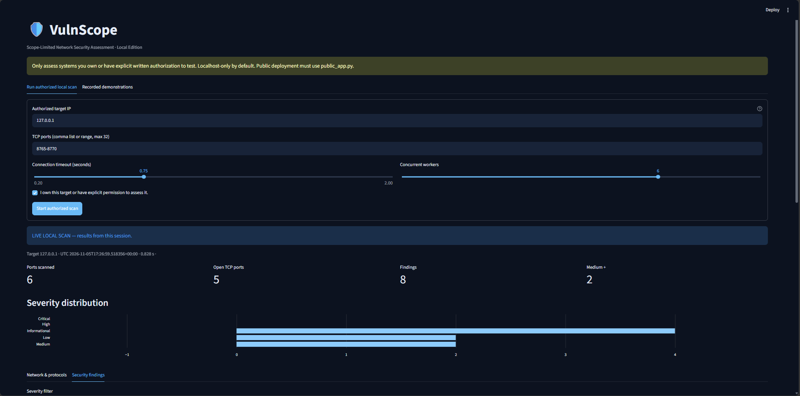
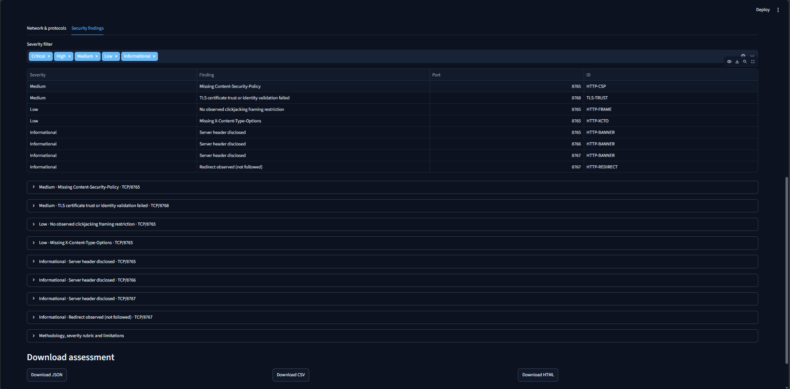

# 🛡️ VulnScope — Python Vulnerability Scanner


**[Live Demo](https://vulnscope-mtt.streamlit.app/)** | **[GitHub Repository](https://github.com/mtt8487-cmyk/vulnscope-python)**

VulnScope is a Python-based network vulnerability assessment tool featuring TCP port scanning, HTTP security checks, TLS certificate analysis, and automated security reporting.

The public demo provides an interactive exploration of recorded security assessments. Live authorized scanning is available in the locally installed application.


**A real, scope-limited network configuration assessment and reporting application.**

VulnScope performs authorized TCP connect scans, conservative service identification, read-only HTTP header checks, TLS certificate analysis, explainable security findings, and downloadable assessment reports. It includes a dark-themed Streamlit dashboard and five **recorded, real loopback-lab scan results** for safe recruiter demonstrations. **No exploits, brute force, or arbitrary public-internet scanning.**


## Application Screenshots

### Local Vulnerability Scanner



### Security Findings




## Features

| Component | Implementation | Limitations |
|---|---|---|
| Scope control | Exact-IP allowlist; authorization checkbox; localhost-only default | No arbitrary DNS, public IPs or subnets |
| Network checks | TCP connect on up to 32 ports; refused/timeout/error separated | Successful connect ≠ security defect |
| Services | Standard port-hint mapping and limited passive banners | No authenticated service/version fingerprints |
| HTTP | Direct `HEAD /`, security headers, redirect observation, no redirect following | One page only; no JavaScript, crawling or authentication |
| TLS | Verified certificate trust and hostname/IP; dates, cipher and protocol | Does not exhaustively enumerate TLS versions or cipher suites |
| Findings | Documented rules, evidence, severity, remediation, references and limitations | No automatic CVE/CVSS claims |
| Reporting | JSON, CSV and standalone HTML | CSV exports findings only; JSON preserves full scan |
| UI | Local scanner + separate public read-only Streamlit explorer | Demo is historical, not a live assessment |
| Tests | 51 automated tests in the packaged build | Tests are not a formal security audit |

## Quick start (Windows 11, PowerShell, Python 3.11)

1. Download and extract the ZIP so this file is inside `vulnscope-python`.
2. Open PowerShell in the **project folder**.
3. Paste these commands individually:

```powershell
py -3.11 --version
py -3.11 -m venv .venv
.\.venv\Scripts\python.exe -m pip install --upgrade pip
.\.venv\Scripts\python.exe -m pip install -r requirements-dev.txt
.\.venv\Scripts\python.exe -m pytest -q
```

**Start the controlled local lab** in one PowerShell window:

```powershell
.\.venv\Scripts\python.exe demo_lab.py
```

**Start the local scanner** in a second PowerShell window, in the same project folder:

```powershell
.\.venv\Scripts\python.exe -m streamlit run app.py
```

Open the localhost address shown by Streamlit (normally `http://localhost:8501`). Enter target `127.0.0.1`, ports `8765-8770`, check the authorization box, and start an assessment. Turn off the lab with `Ctrl+C` in its terminal.

**Generate reports directly:** with lab running, from another PowerShell window:

```powershell
.\.venv\Scripts\python.exe cli.py --target 127.0.0.1 --ports 8765-8770 --authorized
```

Files appear in the locally ignored `reports` folder.

## Public demonstration (read-only)

```powershell
.\.venv\Scripts\python.exe -m streamlit run public_app.py
```

This is the ONLY entrypoint recommended for Streamlit Community Cloud. It loads committed, labeled, historical JSON lab samples and can generate CSV/JSON/HTML downloads; it imports **no network-scanning modules**.

### Five reproducible demos

Run `.\.venv\Scripts\python.exe record_demos.py` to replace all five JSON fixture files with **actual fresh local scans**, produced by starting temporary loopback test servers internally:

1. Missing HTTP security headers (8765)
2. Hardened HTTP headers (8766)
3. Local HTTP redirect (8767)
4. Self-signed TLS identity (8768)
5. Multi-port assessment, including an intentionally closed port (8765–8770)

The sample files shipped with the project are real recordings captured by this test workflow. Their historical timestamps are included. A self-signed lab certificate is an intentional training condition—not evidence of an exposed production system.

## Architecture

```text
app.py                 Local Streamlit scanner (do not deploy)
public_app.py          Read-only recruiter demo (deploy this one)
cli.py                 Command-line scan and report export
demo_lab.py            Local-only HTTP/HTTPS/TCP lab
record_demos.py        Fresh genuine scan fixtures
vulnscope/
  config.py            Port limits, service hints
  scope.py             Target validation + IP allowlist
  network.py           TCP connect checks
  services.py          Conservative service identification
  http_checks.py       No-redirect HEAD requests
  tls_checks.py        Verified TLS + labeled diagnostic certificate capture
  findings.py          Evidence-based rules and severity rubric
  scanner.py           Assessment orchestration
  reporting.py         JSON, CSV and escaped HTML reports
  demos.py             Read-only saved fixture loader
  ui.py                Shared Streamlit display
samples/               Five recorded lab assessments + HTML example
screenshots/           Folder for your actual local dashboard screenshots
tests/                 Automated tests
docs/                  Detailed 12-phase setup + interview preparation
```

## Security boundaries

- **Authorization required:** explicit ownership/permission acknowledgment for every local scan.
- **Strict allowlisting:** localhost by default. Set `VULNSCOPE_ALLOWED_TARGETS` yourself for an exact approved private lab IP, for example `$env:VULNSCOPE_ALLOWED_TARGETS="192.168.1.50"`. No public/global addresses, DNS, or CIDR sweeps accepted.
- **No SSRF redirects:** HTTP uses direct connections to a validated IP literal, requests only `HEAD /`, does not follow redirects and cannot use external proxy configuration.
- **Rate limits:** max 32 ports, max 8 workers, max 2-second per-connection timeout, bounded assessment time budget.
- **No secrets:** local TLS key material generated in a temporary directory and destroyed at lab shutdown. Output from real assessments belongs in the Git-ignored `reports/` directory.
- **No false certainty:** findings may be contextual; verify manually. No reliable software-version identification or CVE correlation is claimed.

## Current verification

At packaging time, 50 automated tests passed on Linux / Python 3.13.5, and the sample scans were actually executed against local test servers. **Python 3.11/Windows 11 execution and a live Streamlit browser demonstration still need validation on the user's machine.**


## Authoritative references

- [OWASP HTTP Security Headers Cheat Sheet](https://cheatsheetseries.owasp.org/cheatsheets/HTTP_Headers_Cheat_Sheet.html)
- [Python 3.11 `ssl` reference](https://docs.python.org/3.11/library/ssl.html)
- [Mozilla Server Side TLS guidance](https://wiki.mozilla.org/Security/Server_Side_TLS)
- [NVD developer documentation](https://nvd.nist.gov/developers)
- [CISA Known Exploited Vulnerabilities catalog](https://www.cisa.gov/known-exploited-vulnerabilities-catalog)
- [Streamlit Community Cloud deployment](https://docs.streamlit.io/deploy/streamlit-community-cloud/deploy-your-app/deploy)

## License

MIT. See [LICENSE](LICENSE). Authorized educational use only. No scanner can certify a target as secure.
